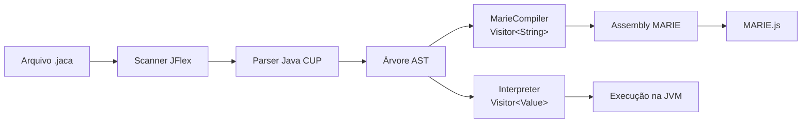

# Compilador Jaca para MARIE

O programa lê uma fonte Jaca, constrói a AST com JFlex e Java CUP e traduz essa árvore para assembly da máquina didática MARIE. O projeto-base também é preservado como interpretador. Assim, a mesma linguagem pode ser interpretada para comparação ou compilada para execução no simulador MARIE.js.

## Visão geral



O scanner e o parser reconhecem a linguagem. O parser não gera código diretamente: ele cria nós da AST. O interpretador e o compilador percorrem os mesmos nós, cada um com um resultado diferente.

## Requisitos

- JDK 17 ou superior.
- Maven 3.8 ou superior.
- Para executar o assembly manualmente: um navegador com o simulador [MARIE.js](https://marie-js.github.io/MARIE.js/).

O Maven gera o scanner e o parser a partir das especificações mantidas em `src/main/jflex/scanner.jflex` e `src/main/cup/parser.cup`. Não edite os arquivos gerados dentro de `target/`.

## Compilar e testar o projeto

Execute os comandos a partir desta pasta:

```bash
mvn clean test
mvn clean package
```

O JAR executável, com as dependências de execução, será criado em:

```text
target/jacacc-1.0-jar-with-dependencies.jar
```

Os testes incluem um simulador MARIE reduzido em `src/test/java/parser/MarieTestMachine.java`. Ele executa as instruções emitidas pelo compilador para testar cálculos, desvios, entrada e saída sem depender de um serviço externo. O simulador auxiliar existe apenas no código de teste; a execução manual recomendada é no MARIE.js.

## Comandos

### Interpretar um arquivo

O modo explícito é:

```bash
java -jar target/jacacc-1.0-jar-with-dependencies.jar --interpret exemplos/fatorial.jaca
```

O uso histórico continua válido:

```bash
java -jar target/jacacc-1.0-jar-with-dependencies.jar exemplos/fatorial.jaca
```

### Compilar para MARIE

Para imprimir assembly no terminal:

```bash
java -jar target/jacacc-1.0-jar-with-dependencies.jar --compile exemplos/fatorial.jaca
```

Para salvar em um arquivo:

```bash
java -jar target/jacacc-1.0-jar-with-dependencies.jar --compile exemplos/fatorial.jaca -o exemplos/fatorial.mas
```

O texto salvo em `.mas` pode ser aberto em um editor ou colado no MARIE.js. Mensagens de confirmação de gravação são enviadas ao `stderr`; o assembly em si vai para `stdout` quando não se usa `-o`.

### Ajuda

```bash
java -jar target/jacacc-1.0-jar-with-dependencies.jar --help
```

### REPL do interpretador

Sem argumentos, o programa inicia o REPL:

```bash
java -jar target/jacacc-1.0-jar-with-dependencies.jar
```

Digite um bloco de comandos e finalize com uma linha vazia. Digite `exit` para encerrar.

## Como usar o assembly no MARIE.js

1. Compile uma fonte Jaca com `--compile` e `-o`, ou copie o texto do terminal.
2. Abra o MARIE.js.
3. Cole o conteúdo completo, incluindo `ORG`, `HALT` e a área de dados.
4. Use o comando de montagem do simulador e corrija qualquer erro de sintaxe indicado.
5. Execute o programa. Para uma instrução `INPUT`, informe um número inteiro no campo de entrada do simulador; os valores de `OUTPUT` aparecem no painel de saída.

O assembly inclui comentários em cada instrução gerada. Comentários MARIE começam com `/`. As declarações usam rótulos seguidos por vírgula; por isso, o compilador evita vírgulas nos comentários.

## Linguagem Jaca implementada

As construções aceitas pelo parser-base são:

| Construção | Exemplo |
| --- | --- |
| Atribuição | `total = 12;` |
| Impressão | `print(total + 1);` |
| Leitura numérica | `read(total);` |
| Bloco | `{ total = total + 1; print(total); }` |
| Comando vazio | `;` |
| Condicional sem `else` | `if (total > 0) then { print(total); }` |
| Condicional com `else` | `if (total == 0) then { print(0); } else { print(1); }` |
| Repetição | `while (total < 10) { total = total + 1; }` |

Operadores de expressão:

| Classe | Operadores |
| --- | --- |
| Menos unário | `-expressão` |
| Multiplicativo | `*`, `/`, `%` |
| Aditivo | `+`, `-` |
| Comparação e igualdade | `==`, `!=`, `<`, `>`, `<=`, `>=` |

O parser define menos unário como a precedência mais alta, seguido por `*`, `/`, `%`, depois `+`, `-`, e por fim os comparadores e operadores de igualdade. Os operadores binários são associativos à esquerda. Parênteses alteram a ordem de avaliação.

Comentários de fonte Jaca começam com `#` e vão até o fim da linha.

## Arquitetura e responsabilidades

| Arquivo ou pacote | Responsabilidade |
| --- | --- |
| `src/main/jflex/scanner.jflex` | Converte caracteres Jaca em tokens, identificadores e números. |
| `src/main/cup/parser.cup` | Define a gramática e cria nós da AST; também permite blocos vazios. |
| `src/main/java/parser/Main.java` | Interpreta argumentos, abre arquivos, e escolhe interpretação ou compilação. |
| `src/main/java/parser/ast/ASTNode.java` | Define o contrato comum para nós visitáveis. |
| `src/main/java/parser/ast/ASTVisitor.java` | Define os métodos que cada visitor implementa para comandos e expressões. |
| `src/main/java/parser/ast/Interpreter.java` | Executa a AST na JVM e preserva a semântica preexistente. |
| `src/main/java/parser/ast/MarieCompiler.java` | Implementa `ASTVisitor<String>` e traduz cada nó em instruções MARIE. |
| `src/main/java/parser/ast/compiler/MarieContext.java` | Administra rótulos, constantes, variáveis, temporários, formatação e memória. |
| `src/test/java/parser/MarieCompilerTest.java` | Testa parsing, assembly, operações, limites e fluxo de controle. |
| `src/test/java/parser/MarieTestMachine.java` | Simulador de teste para as instruções produzidas pelo tradutor. |
| `examples/` | Programas Jaca e saída assembly de referência. |

### Caminho de uma compilação

1. `Main` abre a fonte e cria um `Scanner`.
2. O parser CUP chama as ações semânticas da gramática e constrói a AST.
3. `MarieCompiler.compile(root)` cria um `MarieContext` novo e chama `root.accept(this)`.
4. Cada `visit` retorna assembly. Para expressões, o valor final fica no acumulador `AC`.
5. `MarieContext` monta `ORG 100`, corpo, `HALT`, trap de divisão por zero quando necessário e declarações de dados.
6. O resultado completo é impresso ou escrito no arquivo de saída.

## Convenções de geração

### Acumulador e memória

MARIE tem um acumulador de 16 bits e não oferece registradores de uso geral. `LOAD`, `STORE`, `ADD` e `SUBT` leem ou escrevem palavras de memória. Por esse motivo:

- Toda expressão termina com o valor calculado em `AC`.
- Valores intermediários são guardados em temporários `T0`, `T1` e assim por diante.
- Variáveis são declaradas como `V0`, `V1` etc., inicializadas com `DEC 0`.
- Constantes inteiras são reaproveitadas em `C0`, `C1` etc.
- Rótulos de fluxo são gerados como `L0`, `L1` etc. e nunca dependem do nome escrito pelo usuário.
- O estado e os contadores são reiniciados a cada chamada de `compile`.

Rótulos de variáveis e temporários não reutilizam nomes Jaca. Isso evita colisões mesmo que o programa use um identificador chamado `L0`, `C0` ou `T0`.

### Atribuição, entrada e saída

- `x = expressão;`: código da expressão seguido de `STORE Vn`.
- `read(x);`: `INPUT` seguido de `STORE Vn`.
- `print(expressão);`: código da expressão seguido de `OUTPUT`.
- Blocos concatenam os comandos em ordem. Comandos vazios não geram instruções.

### Soma, subtração e menos unário

Para `a + b` ou `a - b`, o compilador avalia primeiro `b`, guarda-o em um temporário, avalia `a` e emite `ADD` ou `SUBT` com o temporário. A ordem é importante: `SUBT` calcula `AC - memória`, portanto a sequência produz `a - b`.

O menos unário é traduzido como zero menos o valor guardado em memória. O literal `-32768` tem tratamento próprio porque `+32768` não cabe como palavra signed, mas o resultado negativo cabe.

### Multiplicação

Como MARIE não tem instrução de multiplicação, o compilador soma o fator `a` repetidamente usando `b` como contador:

- Se `b` for positivo, soma `a` e reduz o contador até zero.
- Se `b` for negativo, soma `-a` e aproxima o contador de zero.
- Se `b` for zero, o resultado permanece zero.

Essa forma também trata o contador `-32768`, ainda que exija mais iterações. O acumulador do produto e os fatores ficam em endereços diferentes, evitando que expressões aninhadas sobrescrevam valores.

### Divisão e resto

Divisão e resto usam subtrações sucessivas do divisor em direção a zero. O código escolhe um dos quatro casos de sinais dos operandos, verifica se o resto chegou a zero e compara o próximo resto candidato antes de aceitá-lo. Assim, não precisa representar o valor absoluto de `-32768`.

- `/` produz quociente inteiro truncado em direção a zero.
- `%` produz o resto com o sinal do dividendo, igual à regra de inteiros do Java.
- Um divisor zero salta para `DIVZERO`, um rótulo que executa `HALT`, sem entrar em laço infinito.
- O algoritmo é didático e pode gerar muitas instruções executadas para operandos de grande magnitude.

### Comparações

Para comparar `a` e `b`, o compilador calcula `a - b` e aplica `SKIPCOND`:

| Operador Jaca | Teste MARIE usado |
| --- | --- |
| `<` | AC negativo (`SKIPCOND 000`) |
| `>` | AC positivo (`SKIPCOND 800`) |
| `==` | AC zero (`SKIPCOND 400`) |
| `>=` | inversão do teste de `<` |
| `<=` | inversão do teste de `>` |
| `!=` | inversão do teste de `==` |

Cada comparação deixa `1` quando verdadeira e `0` quando falsa. `SKIPCOND` pula exatamente a próxima instrução; o código gerado usa saltos adjacentes para tratar os dois resultados sem ambiguidade.

### `if`, `else` e `while`

- `if` calcula a condição, testa `AC > 0` e salta para `else` ou para o fim.
- O caminho verdadeiro salta o `else` depois de executado.
- `while` coloca o rótulo de início antes da condição, para reavaliá-la em cada iteração.
- Um `CLEAR` serve como âncora em destinos que poderiam corresponder a blocos vazios.
- A gramática aceita `{}` e `{ ; }`.

## Limites e diferenças entre o interpretador e MARIE

- MARIE implementa palavras de 16 bits em complemento de dois. O intervalo signed é `-32768` a `32767`.
- Literais numéricos do Jaca são truncados em direção a zero Por exemplo, `3.9` vira `3` e `-3.9` vira `-3`.
- O literal truncado precisa caber no intervalo MARIE. `32768` isolado é rejeitado; `-32768` é aceito pelo tratamento do menos unário.
- Resultados de operações aritméticas em runtime são palavras de 16 bits: overflow volta ao intervalo em complemento de dois. Por exemplo, `32767 + 1` resulta em `-32768`.
- O interpretador Java trabalha com `Double` e pode diferir em frações, overflow e divisão. Use os exemplos inteiros para comparar as duas execuções.
- Comparações produzem `0` ou `1` no assembly. MARIE não mantém a distinção entre número e booleano que o `Value` do interpretador possui.
- `read` no assembly é numérico. O interpretador-base também aceita `true` e `false`, mas essa forma não é representável por `INPUT` numérico MARIE.
- Variáveis compiladas são reservadas como `DEC 0`. O interpretador pode reportar uso antes de atribuição; o assembly começa com zero porque MARIE não tem essa verificação semântica.
- A memória é limitada a 4096 palavras. Como o código começa no endereço 100, o compilador rejeita a saída se instruções e dados excederem as 3996 palavras disponíveis.
- Não há validação de overflow aritmético em runtime. A máquina armazena o padrão de 16 bits produzido por `ADD` e `SUBT`.

## Exemplos

Os arquivos `.jaca` abaixo cobrem os recursos principais. Para compilar qualquer exemplo:

```bash
java -jar target/jacacc-1.0-jar-with-dependencies.jar --compile examples/fatorial.jaca -o examples/fatorial.mas
```

### Aritmética e precedência

```jaca
print(1 + 2 * 3);
print((1 + 2) * 3);
```

Saída esperada: `7` e `9`.

### Negativos, divisão e resto

```jaca
print(-3 * 4);
print(-17 / 5);
print(-17 % 5);
```

Saída esperada: `-12`, `-3` e `-2`.

### Entrada

```jaca
read(valor);
print(valor);
```

Digite um inteiro quando o MARIE.js executar `INPUT`; o mesmo inteiro será impresso.

### Contagem e fatorial

```jaca
i = 1;
while (i <= 10) {
    print(i);
    i = i + 1;
}

n = 5;
f = 1;
while (n > 1) {
    f = f * n;
    n = n - 1;
}
print(f);
```

A primeira repetição imprime de `1` a `10`; o fatorial de `5` imprime `120`.

## Diagnóstico de erros comuns

| Sintoma | Verificação |
| --- | --- |
| `Arquivo nao encontrado` | Confirme o caminho informado à opção `--compile` ou `--interpret`. |
| Literal fora do intervalo | Lembre que literais MARIE são signed de 16 bits e são truncados antes da validação. |
| `Rotulo MARIE nao encontrado` | Confirme que o assembly foi gerado por inteiro, sem remover rótulos internos. |
| MARIE.js informa erro ao montar | Cole o assembly completo; verifique se os comentários com `/` e as vírgulas dos rótulos foram preservados. |
| Execução para em `DIVZERO` | O programa tentou dividir ou obter resto usando divisor zero. |
| Resultado diferente do interpretador | Verifique decimais, limites/overflow de 16 bits e entrada booleana, que têm regras diferentes na MARIE. |
| Programa ultrapassa memória | Reduza o programa ou o número de temporários; MARIE tem 4K palavras e o código começa no endereço 100. |

## Estrutura principal

```text
jaca-marie/
├── examples/                         # Fontes Jaca e assembly demonstrativo
├── src/main/cup/parser.cup           # Gramática e ações que constroem a AST
├── src/main/jflex/scanner.jflex      # Especificação do scanner
├── src/main/java/parser/Main.java    # CLI, parser, interpretador e compilador
├── src/main/java/parser/ast/
│   ├── Interpreter.java              # Visitor de execução JVM preservado
│   ├── MarieCompiler.java            # Visitor que gera assembly
│   ├── compiler/MarieContext.java    # Rótulos e seção de dados
│   ├── expression/                   # Nós de expressão compartilhados
│   └── statement/                    # Nós de comando compartilhados
└── src/test/java/parser/             # Testes JUnit e simulador auxiliar
```
